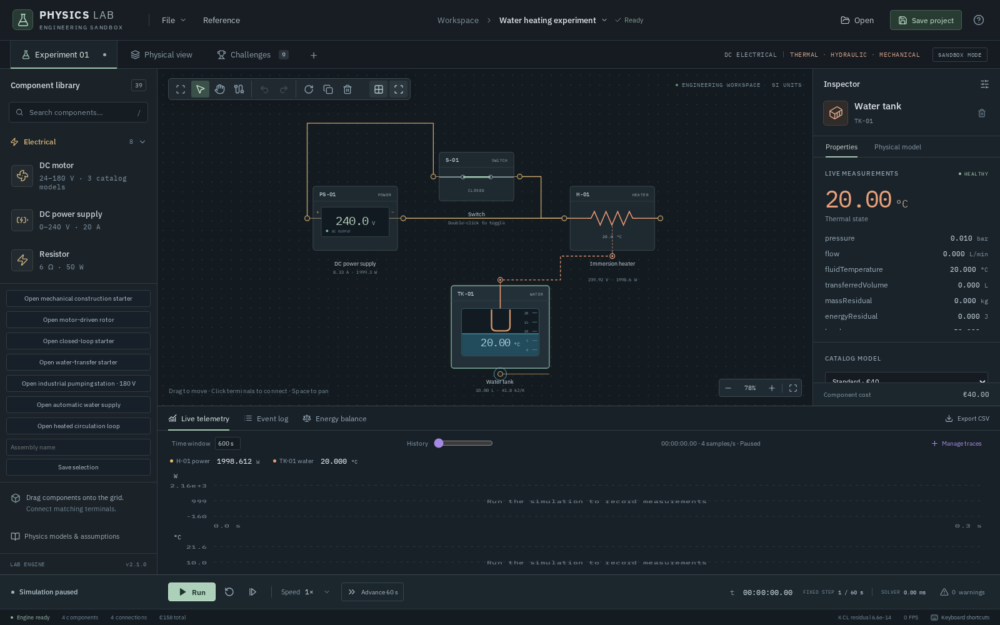
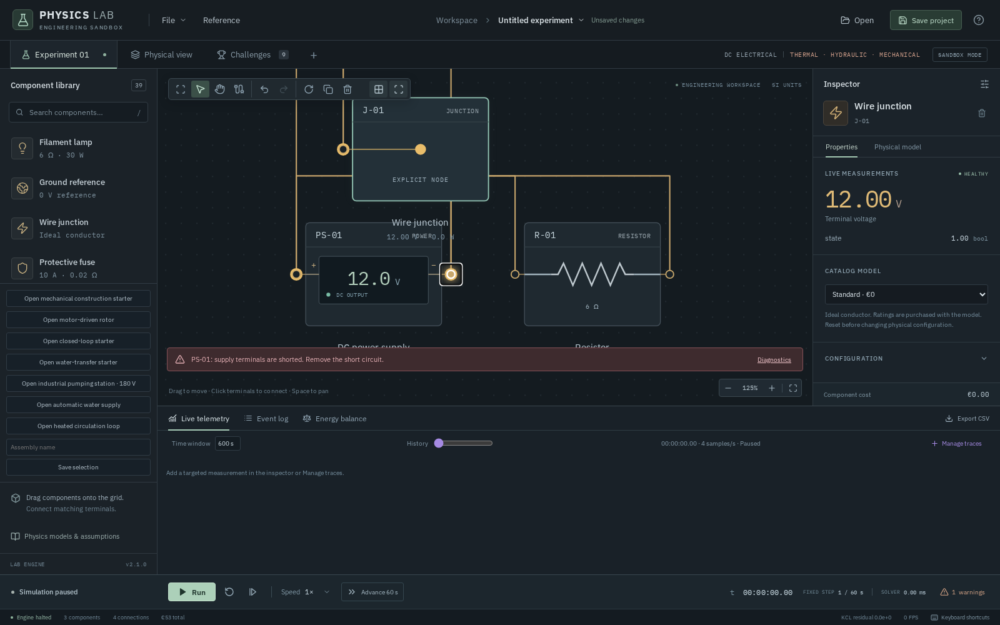
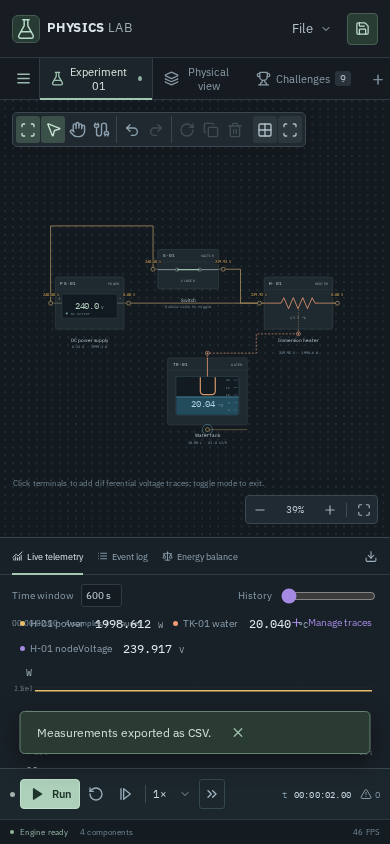
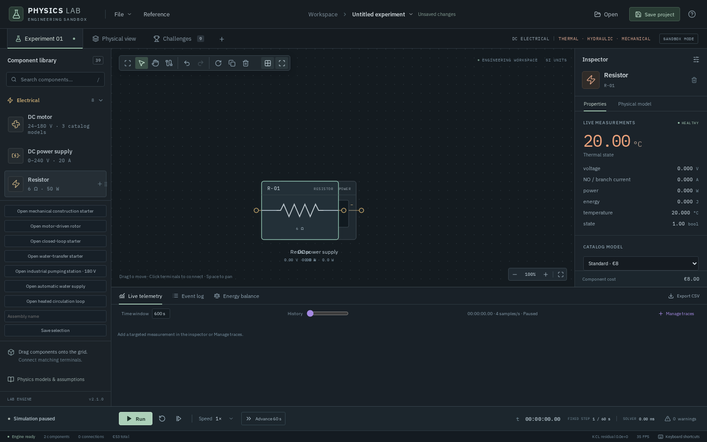

# PHYSICS LAB — INDEPENDENT TECHNICAL, SCIENTIFIC & UX AUDIT

**Audit date:** 9 October 2026. **Target supplied:** https://fracht.lennartobst.de:8080. **Target actually exercised:** http://fracht.lennartobst.de:8080/ following a confirmed TLS failure. **Method:** browser interaction, independent analytical calculations, project import/export and supplementary local source inspection. No application changes were implemented.

## A. Executive assessment

PHYSICS LAB is a capable teaching sandbox with unusually substantial coupling for a browser application. This audit directly verified resistive DC circuits, two-mass heating, automatic regulation, independent protection, finite hydraulic transfer, load-dependent motor behavior and spatial mechanics. Its strongest feature is making these domains share a working experiment with measurements, fault injection and replay. It is sufficiently developed to support meaningful engineering exercises, rather than only animated demonstrations.

It is not ready to be trusted as a general engineering analysis tool. A simple unfinished-wire transition can blank the interface, failed electrical solutions retain misleading values on some display/API paths, and the supplied HTTPS URL does not work. Electrical breadth is narrow: passive resistance and ideal DC sources dominate, with no standalone reactive or semiconductor devices. Small-screen instrumentation and crowded component browsing undermine the otherwise coherent workspace.

The tested DC and thermal examples agree with analytical references. Hydraulic conservation residuals are small in the exercised cases and the motor responds to hydraulic load. These results support **bounded scientific credibility for the exercised models**, not validation of every supported topology or parameter range. Rigid-body results must be assessed separately because their numerical energy error is materially larger than the thermal solve's residual. The weighted product rating is **6.85/10 (rounded 6.9), with medium confidence**. No claim of equipment certification or high-fidelity fluid dynamics is justified.

The construction/control loop is engaging when it works: wiring a plant, watching it respond and then defeating a welded relay with independent protection is meaningful. This is an evaluator judgment, not a user-study result. Challenge scaffolds also provide much of the engineering design in advance, limiting the inference that successful completion demonstrates original system design. Current maturity is an advanced educational prototype requiring reliability and measurement-validity stabilization before expanding its physics scope.

The weighted rating and full coverage qualifications appear below. The issue register contains nine findings, with two rated P1. Unsupported advanced models are treated as scope limits, not incorrect physics.

## Audit protocol and evidence

The browser was Playwright-driven headless **Chromium 156.0.8078.4** on Linux; primary viewport **1600×1000**, mobile **390×844**. Chromium's missing OS/font libraries were extracted to `/tmp/physics-browser-libs`, outside the application. The initial browser setup failure was environmental and is not a product defect. HTTPS failed even after the browser environment was repaired. HTTP then loaded the real deployed application successfully.

Construction, wiring, parameter changes, faults, challenge selection, Run/Pause, step/advance, save/import, trace selection and CSV export used browser controls. Long paused runs additionally used the application's registered `advance_lab_simulation` tool, which invokes the same fixed-step action as the UI. An init script captured the app's three `document.modelContext` tools; `read_lab_measurements` provided full-precision calculated values. These are internal calculated measurements, not independent sensors or solver implementations. Screenshots and UI text corroborate selected values. The first 60-second heating run used the visible Advance 60 s button.

Simple resistor circuits were placed and wired through the UI. Exact series, cooling, mixing, timer and some boundary fixtures were imported through the real project loader. Their JSON files are preserved. Challenge wiring recipes and schema details were assisted by local source/examples after first-use exploration; scores therefore demonstrate that the deployed assignments are playable, not that a blind participant independently discovered their solutions. Challenges were started in the UI, wired terminal by terminal and run against their actual rules.

The local workspace already contained substantial changes and validation artifacts. No developer-authored prior validation result was accepted as this audit's own evidence. A fresh `npm test` run is included as supplementary local evidence only. Remote JS/CSS asset names differ from local `dist`, so local source hypotheses and test outcomes do not establish byte-identical deployed behavior.

Evidence index:

- [First session measurements](audit-evidence/observations.json), [extended tests](audit-evidence/extended-observations.json), [boundary/UX tests](audit-evidence/edge-observations.json), [additional verification](audit-evidence/verification-observations.json).
- [Challenge runs](audit-evidence/challenge-observations.json), [Thermal Runaway run](audit-evidence/runaway-observations.json), [mechanical runs](audit-evidence/mechanical-observations.json).
- [Independent reference script](audit-evidence/reference-calculations.py), [reference results](audit-evidence/reference-results.json), [CSV sample](audit-evidence/measurements.csv).
- Scripts and logs reside in [audit-evidence](audit-evidence/). Saved `.physics.json` files include both scenario configurations and live-run archives. Import them through Open. A live archive recomputes its final state, and may take appreciable wall time.
- The initial electrical session's same-component short attempt was rejected correctly and did **not** create a short. E05 conclusions use the later junction-mediated short. One initial pipe-diameter experiment retained a closed valve after Reset; it is excluded from comparative conclusions. The independent baseline sweeps replace it.
- One Thermal Runaway attempt hit an audit-script error from calling `innerText` on SVG text. A corrected `textContent` rerun completed the assignment. This harness error is not a product defect.

## B. Full feature inventory

**Status definitions:** V = fully functional and verified for the explicitly exercised path; L = functional with limitations or incompletely verified submodes; NT = discovered but not tested; NA = not available in the discovered UI/catalog. These labels do not imply exhaustive scientific validation. No catalog entry was labeled nonfunctional merely because it was not exercised.

### All 39 discovered catalog entries

| Domain | Component | Status | Evidence / scope |
|---|---|---|---|
| Electrical | DC power supply | L | Voltage editing, return path, ratings and ideal-source short rejection tested; no physical current regulation |
| Electrical | Resistor | V | Single, series, parallel, thermal dissipation and overload fail-open |
| Electrical | Switch | V | Finite 0.01 Ω on resistance, live open/close, undo/redo |
| Electrical | Filament lamp | L | Challenge 001 lit safely; constant resistance, no filament dynamics |
| Electrical | Ground reference | NT | Catalog/reference discovery only; explicit multi-island ground experiments not run |
| Electrical | Wire junction | V | Branching and source-short construction |
| Electrical | Protective fuse | L | Overcurrent opens; reset; detailed I²t/selectivity unsupported |
| Electrical | DC motor | L | Three models discovered; laboratory/traction/industrial use, load feedback and shared spatial shaft exercised |
| Hydraulic | Centrifugal pump | L | Positive-head transfer, valve loading and dry boundary; cavitation/turbine operation unsupported |
| Hydraulic | Pipe | L | Diameter, length, friction and thermal transport exercised; zero fluid inventory / travel time |
| Hydraulic | Manual valve | V | 100%, 20%, 0% opening changes operating point and isolates flow |
| Hydraulic | Check valve | NT | Catalog entry; pump's built-in reverse check is a separate model |
| Hydraulic | Actuated valve | NT | Stroke/fail-position behavior not independently exercised |
| Hydraulic | Fluid junction | NT | Catalog entry; dedicated multi-inlet mixing-junction test not run |
| Mechanical | Rigid body | L | Build/edit, gravity, collision starter, rotating shaft and lift/descent scenes exercised |
| Mechanical | Force / brake actuator | L | Passive descent braking and variable torque load; arbitrary force-input cases untested |
| Thermal | Immersion heater | V | Ohmic power, separate thermal mass and post-cutoff stored-energy transfer |
| Thermal | Water tank | L | Finite inventory, 1–95°C bounds, mass/mixing, loss, locked live configuration |
| Thermal | Cooling jacket | L | Normal and faulted thermal-control runs; ideal infinite coolant reservoir |
| Sensors | Position sensor | L | Lift feedback; axis/noise/lag variants not comprehensively tested |
| Sensors | Shaft speed sensor | L | Rotational feedback assignment; fault/range sweep not run |
| Sensors | Pressure sensor | L | Pressure assignment reads and controls actual hydraulic node; calibration sweep not run |
| Sensors | Flow sensor | NT | Catalog entry; flow itself measured from branch probes |
| Sensors | Tank level sensor | L | Automatic supply, source interlock, injected primary failure |
| Sensors | Voltmeter | L | Differential voltage and 10 MΩ loading work; primary inspector incorrectly emphasizes temperature (INS-001) |
| Sensors | Temperature sensor | L | Hysteresis feedback and sensorFault; noise/lag/resolution sweep not run |
| Automation | PI regulator | L | Hydraulic and spatial feedback; full saturation/anti-windup test not run |
| Automation | Comparator | L | Timer source and level guards; all comparison modes not tested |
| Automation | Hysteresis controller | V | 78/80°C heating and 30/90% tank-level control |
| Automation | Control relay | L | Normal operation, sensor-fault response and stuckClosed; full SPDT NC path not tested |
| Automation | Thermostat | NT | Combined sensor/controller catalog entry; standalone device not exercised |
| Automation | Simulation timer | L | TON and three speed settings; TOF and pulse untested |
| Automation | AND gate | L | Supply interlocks exercised; complete truth-table fault coverage not run |
| Automation | OR gate | NT | Catalog entry |
| Automation | NOT gate | NT | Catalog entry |
| Automation | Numeric constant | NT | Catalog entry |
| Automation | Set/reset latch | NT | Catalog entry |
| Automation | Manual reset signal | NT | Separate component not used; cutoff's inspector reset action was used |
| Automation | Independent cutoff | V | 90°C latching trip, independent interruption of welded relay, manual recovery |

### Editor, instruments and services

| Feature | Status | Verification / limitations |
|---|---|---|
| Five terminal domains | L | Electrical, thermal, control, hydraulic and shaft links used; mixed electrical/thermal link rejected with clear message |
| Drag placement | V | Used to construct resistance networks after click-overlap problem |
| Click placement | L | Inserts components but overlaps them: UX-001 |
| Terminal wiring, keyboard wiring | V | Pointer and focused Enter wiring both exercised |
| Move / rotate / delete | L | Connected component move, rotation, delete and deletion undo exercised; wire-routing/deletion gestures not exhaustively covered |
| Multi-selection and connected duplication | V | Four-component heater duplicated with all four internal connections; undo restored original |
| Copy/paste | NT | Shortcut documented; not directly exercised |
| Saved assembly | V | Heater assembly saved and inserted; topology count doubled correctly |
| Undo / redo | L | Property changes and duplication verified; geometry/route history not exhaustively tested |
| Grid, pan, fit, zoom | L | Fit/zoom and placement used; precise snap/alignment and all pan input paths not measured |
| Physical editor / view switching | L | SI geometry, default body editing and shared experiment views; advanced joint authoring not exhaustively exercised |
| Run / Pause / Reset / fast advance | L | Used extensively; reset retains edited scenario settings, restores physical initial state |
| Inspector / catalog variants | L | Operating/configuration distinction verified; some raw identifiers and branch labels are confusing |
| Component probes and mixed-unit charts | L | Heating, hydraulic and mechanical traces; node probe and CSV used; exact hover/cursor behavior not fully audited |
| Differential node probes | V | Source-negative to heater-positive measurement agreed with calculated heater voltage |
| Energy and mass balance panel | L | Accounting checked on thermal, hydraulic and mixing examples; residuals do not prove constitutive accuracy |
| Event log | L | Faults and switching recorded; timer boundary timestamp issue SCI-001 |
| Save / Open live state | V | Hydraulic saved run reproduced full measured state exactly |
| Scenario import and malformed import handling | V | Custom scenarios accepted; invalid JSON/version and forged ratings rejected without replacing prior state |
| Device recovery copy | NT | Save advertises a local copy; recovery action not directly exercised |
| Deterministic replay | V | Hydraulic final state reproduced exactly in the same browser/build |
| Replay scrubbing / backwards time | NA | Reference explicitly says final-state reconstruction, no timeline scrubbing |
| Fault injection | L | sensorFault, stuckClosed and scenario-driven cooling/level faults exercised; other fault types not all tested |
| Challenge mode | L | Nine assignments discovered and exercised; scoring/exploit coverage bounded below |
| Search | L | Library filtering available; full search usability/relevance study not performed |
| Browser tools | L | Read, running-state and paused-advance registration observed; read values inherit solver validity weakness |
| Mobile layout | L | 390 px viewport has no body overflow; telemetry overprints labels |
| Error recovery | Partially functional | Invalid import preserves project; unfinished-wire project transition blanks UI |

### Physical-view construction inventory

| Tool/model family | Discovered options | Verification status |
|---|---|---|
| Geometry | Rectangle, circle, polygon, beam, platform, wall, floor, wheel | Rectangle authored; beam/floor/wheel exercised through starters; remaining creation tools NT |
| Body behavior | Static, dynamic, kinematic; material/dimensions/depth/mass and collision settings | Static/dynamic scenes exercised; kinematic motion and all material/contact combinations NT |
| Joints | Fixed, revolute, prismatic, distance, spring, gear/rack transmission | Revolute/prismatic/spring/gear used in supplied scenes; interactive joint authoring, fixed and distance tests NT |
| Physical transforms | World placement, rotation/resize, grid/snap, alignment, selection/duplication | World Y editing exercised; other physical authoring gestures only discovered or partly covered |
| Diagnostics | Mechanical diagnostics, overlays, force/impulse tools and shaft association | Motion/shaft measurements verified; interactive impulse application and all diagnostic overlays NT |

These options belong to the existing spatial editor and are not future roadmap assumptions. Presence does not verify every constraint or contact model.

### Electrical completeness and unavailable models

The library permits useful resistive circuits, relay logic, heaters, motor loads, protection demonstrations and feedback experiments. It does not yet support general electronics.

| Missing capability | Classification / engineering consequence |
|---|---|
| Variable resistor / potentiometer | Foundational catalog/workflow gap; resistance can be configured before a run, but there is no dedicated live rheostat or three-terminal potentiometer |
| Dedicated ammeter / selectable current clamp | Instrumentation gap; existing component current probes provide the quantity without a physical ammeter model |
| Current source | Foundational DC-solver extension, useful for source/network experiments |
| Circuit breaker / motor starter | Component/control gap; fuse and relay exist, but resettable protection/selectivity and starter circuits need explicit models |
| Battery / generator | Source-model gap; ideal DC supply and motor back EMF are not finite battery chemistry or a general generator model |
| Realistic cables | Wires are ideal; pipe geometry has no electrical equivalent. Cable resistance/ratings can be added before distributed-line research |
| Diode / transistor / MOSFET | Nonlinear DC model and iterative solver work, with convergence/failure diagnostics required |
| Capacitor / inductor | New dynamic electrical state, initialization and stable transient integration needed |
| AC sources / transformer / mains protection | New AC/transient scope; do not add decorative components to a DC-only solver |

Other explicitly documented limits include no boiling/phase change, no finite pipe residence time, no water hammer/cavitation, no distributed spatial mixing, no armature inductance/commutation, no actuator supply losses, no automatic contact heat transfer/fracture, and no moving spatial fluid. These are disclosed model limits, not observed defects. All absent catalog features above are NA in the discovered application, not a claim about undocumented code.

## C. Physics validation report

### Electrical experiments

Sources use the passive sign convention: negative source current/power indicates delivery. The UI often displays a positive supplied-power magnitude; this is consistent when interpreted with that convention.

| Test | Configuration / analytical reference | Observed | Assessment |
|---|---|---|---|
| E01 | 12 V source; one 6 Ω resistor; direct return. I=12/6=2 A; P=24 W | 2 A, 12 V, 24 W | Exact analytical behavior at returned precision |
| E02 | Two 6 Ω resistors, direct 12 V series loop, imported from preserved UI-built components | 1 A; 6 V and 6 W each | Exact analytical behavior |
| E02 variant | Same series circuit plus 0.01 Ω switch: I=12/12.01 | 0.9991673605 A; 5.995004163 V each | Correct finite-switch deviation: −0.08326% from ideal 1 A |
| E03 | Two 6 Ω parallel loads at 12 V: Req=3 Ω | Source delivers 4 A / 48 W; 2 A / 24 W per branch | Exact analytical behavior |
| E04 | Open series switch after 1 s | Branch currents and resistor voltages become 0; switch has 12 V | Correct; no stale values on a valid open-circuit solve |
| E05 | Short source through explicit junction | Names shorted source, prevents run; previous 2 A / 24 W remains flagged valid | Correct rejection, misleading retained telemetry: PHY-002 |
| E06 resistor | 24 V, 6 Ω, 50 W rating: initial P=96 W | Opens at logged 0.52 s; current/power become 0; Reset clears failure | Consistent with 0.5 s exposure model plus fixed-step threshold granularity |
| E06 fuse | 12 V source, 1 Ω resistor, 0.02 Ω fuse rated 10 A: I=11.7647 A | Fuse opens at logged 0.12 s, before resistor overload delay | Consistent within one fixed step of 0.1 s fuse exposure; no real I²t claim |
| E07 | Series source changed 12→6 V after advancement, then undo/redo | I changes 0.999167→0.499584 A and back; thermal state/time retained | Correct operating edit; separate running UI edit also verified |
| Meter | 10 MΩ voltmeter across one resistor in 12 Ω series loop | About 6 V with tiny loading, matching network calculation | Useful independent instrument placement, same underlying solver |

Exact JSON and full-precision values are in E01, E02, E03, E04, E05-short, E06-overload and E02-meter fixtures/archives. The finite-switch variant was wired directly in the browser; the direct E02 reference was imported to remove that extra resistance.

### Thermal experiments and independent calculations

For the heating starter: water volume=10 L, density=1 kg/L, cp=4,180 J/(kg·K), initial/ambient=20°C; water loss=2.2 W/K. Heater R=28.8 Ω, C=300 J/K, heater-to-water UA=180 W/K, heater ambient UA=0.5 W/K. Source=240 V, closed switch R=0.01 Ω. Actual heater input is `(240/(28.8+0.01))² × 28.8 = 1,998.611834 W`; the switch dissipates 0.693962 W.

The water-only requirement for 20→80°C is `10×4,180×60 = 2,508,000 J`, giving 1,254 s at ideal 2 kW with no other storage/loss. It is a lower bound, not the correct coupled heating trajectory.

An independent closed-form two-by-two matrix exponential solved the documented linear heater/water equations, including both ambient losses. The reference script does not import the app solver.

| Test | Analytical / expected | Observed | Deviation / interpretation |
|---|---|---|---|
| T01 after 60 s | Water 22.757304284°C; heater 33.744123744°C | Water 22.757302772°C; heater 33.744122237°C | Water error −0.000001512 K; numerically reasonable backward-Euler approximation |
| T02 power off at 60 s, advance another 60 s | Water 22.824557163°C; heater 22.817033036°C | Water 22.824555663°C; heater 22.817031540°C | Stored heater energy continues warming water; error about −0.0000015 K |
| T03 isolated tank | 10 kg initially 80°C, UA=2.2, ambient 20: T(600)=20+60exp(−2.2×600/41,800)=78.134867611°C | 78.134868416°C | +0.000000805 K; verifies Newton cooling for this parameter set |
| T04 accounting at 120 s | Electrical supply = water + heater + other storage + ambient losses | Supply 119.9583 kJ; water 118.0664; heater 0.8451; other 0.0007; loss 1.0462 | Raw residual +5.146×10⁻⁷ J; rounded panel values should not be used to recompute that residual |
| T05 configuration edits | Mass/initial conditions must not inject energy mid-run | Water volume input disabled after 60 s | Restriction verified; heat capacity/rating are catalog properties, not free live controls |
| T06 95°C initial water with cold powered element | Pause on leaving liquid model range | At t=14.3333 s, water 95.0003083°C; clear range diagnostic | Stable boundary rejection; small endpoint overshoot, no boiling invented |

Heating challenge 002 reaches 80°C at about 1,323.45 s, slower than the water-only bound as expected. This does not independently validate every heater resistance, high conductance or mass extreme. Tiny conservation residuals show balance inside the implementation; they cannot detect a shared wrong material constant or an incorrect constitutive model by themselves.

### Automation and safety

A01 used the built-in closed-loop starter with sensor→78/80 hysteresis→relay, 10 L tank, heater and jacket. It cycled automatically: relay OFF at 1,533.68 s, ON at 1,672.23 s, OFF at 1,736.58 s in the sampled log. Full bands and overshoots require complete recorded traces; these transitions verify cycling without per-frame chatter in this run.

A03 sensorFault at 1,800 s opened the ordinary relay and reduced heater power to 0. A04 stuckClosed on that relay restored about 1,995.84 W. A02 then advanced the same plant: the independent cutoff tripped at logged 2,155.15 s /90°C and opened its own series contact despite the welded relay. At 2,400 s heater power remained 0 and water had cooled to 85.8457°C. Challenge 003 additionally required manual reset and subsequent regulation; it completed successfully with 2 stars.

A05 used a separate TON delay=1 s fixture and real Run/Pause at 0.25×,1×,4×. Every run logged the timer transition at 0.98 s simulation time. Wall-time duration and the final pause timestamp differed, as expected. This supports simulation-clock dependence, with the event-boundary ambiguity recorded in SCI-001. It is not proof of all timer modes or every controller under extreme frame starvation.

### Hydraulic and mechanical experiments

The transfer baseline has a150 L source, empty 120 L destination at 2 m elevation, laboratory 24 V motor/pump,5 m pipe with 25 mm diameter, and fully open valve. Tanks have 0.1 m² surface area. All complete parameters reside in hydraulic-initial.physics.json.

| Test | Observations | Scientific assessment |
|---|---|---|
| H01 finite transfer | At 10 s: source 142.644590 L, destination 7.355410 L (see raw values for final precision); mass residual about−2.95×10⁻¹⁰ kg | Finite source loss corresponds to destination gain |
| H02 elevation sweep | At 10 s, destination heights 0/2/4 m give approximately 60.373/48.345/33.849 L/min | Correct direction of hydrostatic-head response; not a calibrated real pump comparison |
| H03 pipe sweep | At 10 s, halving diameter 25→12.5 mm lowers flow 48.345→17.809 L/min; length 5→50 m lowers it to 28.976 L/min | Physically consistent nonlinear loss response; motor operating point also changes |
| H04 restriction | 20% valve reduces flow;0% produces zero through-flow. Motor still consumes deadhead drag/friction power | Correct isolation, with documented nonzero pump drag model |
| H05 pump/motor | Baseline 10 s: ω229.59297 rad/s, armature 4.69380 A, shaft 59.90798 W, hydraulic 16.50413 W; source 112.651 W | Actual pump overall efficiency≈27.55%; do not confuse internal curve efficiency≈69.93% with total efficiency including drag |
| H06 dry running | Source reduced to 0.1 L; after 10 s it is empty, delivery≈0.1 L, flow 0; dry-run diagnostic, no negative inventory | Inventory protection verified; no cavitation/damage physics inferred |
| H07 mixing |10 L at 60°C elevated 1 m transfers into 10 L at 20°C through a pipe. At 10 s masses≈1.01/18.99 kg; destination 38.925903°C | Lossless mass-weighted reference≈38.93628°C; ambient losses and gravitational dissipation explain the small difference, supported by accounting |
| H07 energy | Mixing panel: potential−0.0802 kJ, water−1.0553 kJ, ambient+1.1356 kJ; residual−0.003305 J | Conservative within small timestep error; no electrical source present |
| H07 circulation | Heated-loop starter ran 60 s with hot-water transport and finite reservoirs | Qualitatively credible transport; not a transit-time model |
| H08 feedback | Changing elevation/diameter/valve changes motor ω and current (e.g.4.69380 A baseline vs 4.83896 A at 4 m) | Actual two-way operating-point coupling observed, beyond one-way animation |
| H09 spatial mechanics | Free fall, collision/hinge/spring starter, passive descent, rack lift and variable-load rotor | See quantitative mechanical appendix below; not all joints/materials validated |

The pump has large declared drag in this educational model. Its low total efficiency at the baseline point is not alone a conservation defect. The raw hydraulic tool's `efficiency` is the internal curve coefficient; the UI measurement path calculates hydraulic/shaft efficiency. Treat these as different quantities until the tool schema names them explicitly.

The hydrostatic and pipe checks use `pbottom=ρgV/A`, `Δp=f(L/D)ρv²/2` and `Phyd=Δp×Q`. These can be recomputed from the saved geometry, measured flow and reported friction factor. Hydraulic solver continuity is small in the sampled cases; no convergence guarantee is inferred for arbitrary loops or multiple conflicting boundary tanks.

### Quantitative spatial mechanics appendix

A newly created dynamic rectangle was placed at y=10 m and advanced 1 s without a floor or applied force. Its saved mass is 135 kg, gravity−9.80665 m/s² and initial velocity 0. Analytical free fall gives `vy=−9.80665 m/s`, `y=10−0.5×9.80665=5.096675 m`. Observed vy=−9.80665 m/s and y=5.086459740 m: a−0.010215260 m position error, about 0.2083% of the analytical fall distance. Initial mechanical energy 13,238.9775 J fell to 13,225.4535397 J; the reported residual 13.5239603 J matches that numerical deficit. No damping/contact source explains it in this scene. This is a measured first-order integration limitation, explicitly acknowledged in the reference, not evidence that the residual was hidden or that every mechanical scene is unstable.

The descent run ended at y=1.019113 m, with 389.189524 J brake loss and 1.202130 J contact loss. Available gravitational energy was about 390.391653 J; its balance residual was approximately 3×10⁻¹¹ J. The rack lift reached y=2.996183 m and small upward speed 0.014917 m/s, with global residual−0.001524 J. The controlled rotor ended near 125.662051 rad/s (≈1199.984 RPM); spatial rotor and motor ω matched. Its residual was approximately−1.2×10⁻¹⁰ J, including signed work removed by the changing shaft load. A combined collision/hinge/spring starter ran 10 s with residual≈1.002887 J. These disparate residuals reinforce the need to validate each integrator/coupling path separately.

Switching the paused free-fall experiment to the schematic view preserved time and the spatial measurements. Gravity-only motion is analytically checked; collision restitution, spring period, constraint reaction forces and every joint type remain **qualitatively observed or unverified**, not scientifically validated. Numerical improvement should begin with published convergence envelopes and accuracy settings, without inventing compensating physical heat for numerical energy error.

## D. UI/UX review

The starter immediately communicates a working electrical/thermal experiment. Color-distinct ports, a property inspector, live component values and a visible simulation clock support an effective first experiment. Invalid electrical-to-thermal wiring gives a useful reason. The reference explains ideal wires, finite switch resistance, model validity limits and the distinction between simulation and physical layout. Keyboard terminal activation works via focused Enter; the app is not exclusively pointer driven.

Construction becomes less efficient as the catalog grows. Click placement overlaps equipment; drag placement is much more reliable. The permanent seven starter shortcuts and assembly tools consume more library height than the scrollable catalog. Inspector measurement rows occupy substantial height before configuration inputs. Contextual measurement names, collapsible advanced readings and a separate starter browser would reduce scanning and scrolling. These are workflow changes, not a request for cosmetic redesign.

Connected duplication and saved assemblies preserve internal connection counts in the tested heater example. Undo/redo operates on voltage changes without resetting time or accumulated temperature. This is important for experiments. However, stale terminal state on project replacement is a core recovery failure. Reset also retains the edited scenario configuration, so comparative experiments must explicitly restore their baseline settings; the audit's initial closed-valve pipe test illustrates the need for a clear distinction between Reset dynamic state and Restore starter defaults.

Instrumentation has meaningful strengths: separate unit plots, component probes, differential node references, a balance panel distinguishing internal conversions from external exchange, and CSV export. Its credibility is damaged when a failed solve leaves old canvas/API results looking live. Follow-up confirmed that detailed inspector electrical rows already become unavailable; the primary junction value and canvas/API are inconsistent with that handling. The voltmeter also emphasizes 20°C as its primary reading while its 6 V measurement is buried below (INS-001). Raw camelCase labels and relay terminology on ordinary currents add unnecessary interpretation. The measured short-circuit diagnostic is actionable, but it must also invalidate the readings it makes impossible.

At 390×844 the overall canvas remains accessible and the body does not overflow horizontally. Nevertheless the telemetry header/readouts overprint one another. Small diagram text becomes very difficult to read at 39% fit. The mobile result proves that a no-horizontal-overflow assertion is inadequate as an accessibility/usability test. No screen-reader study, contrast compliance claim, touch-device test or formal WCAG audit was performed.

Significant visual evidence:

## E. Challenge review

All nine challenge entries are real, distinct assignments. Objectives include voltage/power/budget constraints, finite water inventory, regulation bands, fault recovery and actual shaft feedback. The completion table below records actual observed runs; no untested challenge is awarded a quality judgment. Wiring followed source-assisted recipes for complex scaffolds, as disclosed in the protocol.

| No. | Challenge | Actual result | Simulation time at completion | Intended principle | Evaluation |
|---|---|---|---:|---|---|
| 001 | First Light | 3 stars · 93/100 | 3.01667 s | Closed return path, safe voltage/power | Three wires and a 3 s hold; clear introductory task. Constant-resistance lamp simplifies real behavior. |
| 002 | Heating Challenge | 3 stars · 90/100 | 1323.45000 s | Heat 10 L from 20°C to 80°C within ratings | Useful contrast with the water-only energy bound; more feedback on element storage/loss would improve learning. |
| 003 | Thermal Runaway | 2 stars · 87/100 | 2888.58333 s | Regulation, welded relay, coolant loss, independent isolation and manual recovery | Most substantive safety exercise. A large conceptual jump from heating; phases help but deserve intermediate lessons. |
| 004 | Water Transfer | 3 stars · 91/100 | 144.31667 s | Move at least 100 L uphill from finite inventory | Clear flow/head/inventory goal; prepared equipment reduces topology-design freedom. |
| 005 | Pressure Control | 3 stars · 91/100 | 194.98333 s | 180 s regulated pressure under changing consumer demand | Quantitative band/RMS rules are valuable; source-assisted PI setup passed without a tuning study. |
| 006 | Automated Water Supply | 3 stars · 96/100 | 720.00000 s | 600 s level regulation after commissioning, guards and sensor fault | Exercises real inventory and redundancy. Baseline completion is verified; alternate fault architectures not exhaustively explored. |
| 007 | Controlled Descent | 3 stars · 96/100 | 11.16667 s | Passive brake, impact limit, stable landing | Brake damping 200 N·s/m completed the prepared scene. Good energy exercise; limited construction freedom. |
| 008 | Motorized Lift | 1 stars · 75/100 | 18.10000 s | Electrical motor, rack transmission, position feedback and stable target | Real coupling verified. Baseline earned 75/100; score deductions need an explicit explanation. |
| 009 | Rotational Control | 2 stars · 82/100 | 69.98333 s | 1200 RPM regulation against alternating torque load | Real speed feedback and load changes exercised; baseline scored 82/100. Explain error/energy/economy terms separately. |

The progression from a lamp loop to heating, feedback, fault tolerance and coupled machines has engineering value. First Light and heating are accessible; Thermal Runaway introduces several ideas at once and needs more intermediate feedback exercises. Hydraulic/speed loops provide useful quantitative targets. The descent assignment starts with a prepared guide and landing; tuning its brake is meaningful but narrow. Lift and rotor assignments prebuild their mechanical transmissions and largely leave wiring/controller settings to the learner.

Budget and catalog constraints are explicit and enforce real tradeoffs, although a displayed star count should explain its deductions. The baseline lift achieved only one star while other reference solutions received three; this makes the energy/economy breakdown especially important. Completing a scaffold is weaker evidence of design skill than choosing a topology and specifying its components. Add optional blank-design variants and separate construction, regulation, efficiency and fault-recovery achievements.

Exploit attempts and boundaries:

- Heating source voltage 500 V was rejected; UI retained 240 V with a catalog-range diagnostic.
- Imported heating configurations with initial water 80°C, ambient 95°C, water volume 0.1 L, or heater rating 100,000 W were rejected with specific locked-condition/catalog messages. Prior project state was retained.
- A transfer motor rating 99,999 W was rejected at import. Ratings cannot simply be inflated for free in this path.
- Reset after transfer completion returned progress to 0%; undo did not restore a completed score. Heating reset likewise returned 0%.
- Source-short and component-overload attempts did not earn a successful electrical result. Manual fault injection is restricted in scored scenarios; scripted faults occurred in Thermal Runaway and automatic supply.
- Alternative safe topology optimization, dummy feedback ancestry, archive input tampering, cloned challenge identities, all environmental parameters, browser-storage modification and every undo/replay interaction were **not exhaustively tested**. This is bounded exploit testing, not a proof of exploit resistance.

Recommended learning progression: basic power/return → series/parallel and measurement reference → thermal inertia/loss → thermostat/hysteresis → independent protection → finite transfer/head → feedback tuning → sensor-fault redundancy → spatial energy/control. Give failure explanations that connect measured constraint violations to the relevant physics, and expose score terms after completion.

## F. Prioritized issue register

**Nine findings: 2 P1, 5 P2 and 2 P3.** These include a deployment access defect, editor/instrumentation failures and specific UX weaknesses.

No confirmed P0 scientific impossibility or persistent data corruption was found in the exercised experiments. P1 findings concern the inaccessible supplied URL and a repeatable core editor crash. P2 findings include invalid-solution measurement semantics and significant workflow defects. Missing advanced physics is tracked separately as feature work.

### PHY-001 — Replacing a project with an unfinished wire blanks the entire application

- **Category:** Reliability / editor state
- **Severity:** P1 — High
- **Affected area:** Workspace pending terminal state; project load/new/import transitions
- **Reproduction:** 1. Open the heating starter. 2. Click PS-01 positive terminal once, leaving the wire preview active. 3. Click New empty experiment.
- **Expected:** A usable empty canvas; all transient wire and selection state cleared.
- **Actual:** The root UI disappears. An uncaught exception says “Cannot read properties of undefined (reading 'kind')”. Reloading the page is required.
- **Evidence:** edge-observations.json: pending-wire-crash and pageerror; 21-pending-wire-crash.png. Also encountered independently during the first electrical construction session. (all evidence paths are under `audit-evidence/`).
- **Impact:** A routine construction transition loses the working interface and exposes unsaved work to loss.
- **Suspected cause:** Hypothesis, supported by local source: Workspace holds pending in component state and dereferences a component from the replacement project using a non-null assertion (src/components/Workspace.tsx, pending preview). The local source is not proven identical to the remote build.
- **Recommended fix:** Clear project-bound transient editor state whenever project identity changes; guard lookup before rendering pending previews; add a recoverable application error boundary.
- **Acceptance criteria:** New, challenge switch and import while a wire is pending never throw; the replacement project renders; no terminal from the previous project remains pending. Recovery UI can preserve/export valid project state after an unexpected render exception.
- **Suggested regression tests:** Browser tests for pending wire followed by New, valid import, challenge start and device recovery; assert no pageerror, visible canvas and cleared preview.
- **Complexity / dependencies:** S–M; None.

### PHY-002 — Failed electrical solves retain apparently valid live readings

- **Category:** Instrumentation / numerical failure semantics
- **Severity:** P2 — Medium
- **Affected area:** Electrical solve failure, inspector, canvas, probes, measurement tool and CSV
- **Reproduction:** 1. Import audit-evidence/E01.physics.json (12 V, 6 Ω). 2. Add a wire junction. 3. Wire source positive to the junction and the junction to source negative. 4. Inspect the resistor and source.
- **Expected:** The short is rejected with actionable diagnostics; quantities for the invalid circuit display unavailable or explicitly last-valid with a timestamp.
- **Actual:** The correct short-circuit diagnostic appears and running is prevented, but the read API retains 12 V, 2 A and 24 W with voltageValid=true from the old solution. The canvas still shows those values, and the selected junction shows HEALTHY / 12.00 V. Follow-up confirmed that the resistor inspector's detailed electrical rows already show unavailable values; invalidation is inconsistent across surfaces.
- **Evidence:** extended-observations.json: E05-real-short, E05-real-short-ui, E05-run; 07-real-short.png; E05-short.physics.json. Follow-up evidence: performance-observations.json and 25-stale-short.png; recovery-observations.json confirms Undo recovery after UI settling. (all evidence paths are under `audit-evidence/`).
- **Impact:** An engineer can mistake an obsolete solution for the result of the displayed topology. Zero residual values also cease to mean a successful current solve.
- **Suspected cause:** Hypothesis: the failure path stores an error while leaving the previous electrical result and validity flags intact.
- **Recommended fix:** Attach solution status and revision to calculated outputs. Invalidate dependent readings on failure and propagate that validity through every presentation/export route; preserve last-valid data only behind an explicit label.
- **Acceptance criteria:** For a shorted source no current-solution electrical numeric value is shown as valid. Diagnostic names PS-01 and the remedy. Undo restores the original 2 A / 24 W solution without reload.
- **Suggested regression tests:** Browser and engine tests: valid circuit → short → failed solve → inspector/probes/tool/CSV validity → undo → valid solve. Also test conflicting ideal sources.
- **Complexity / dependencies:** M; None.

### OPS-001 — The supplied HTTPS entry point does not serve TLS

- **Category:** Deployment / access
- **Severity:** P1 — High
- **Affected area:** Public endpoint and reverse proxy
- **Reproduction:** Navigate to https://fracht.lennartobst.de:8080 in Chromium, or run curl -I against that exact URL.
- **Expected:** A successful HTTPS application response, or a documented working HTTPS canonical URL.
- **Actual:** Chromium reports net::ERR_SSL_PROTOCOL_ERROR; curl reports TLS wrong version number. http://fracht.lennartobst.de:8080 returns HTTP 200 and serves the working app.
- **Evidence:** access-checks.txt; remote-index.html. Browser 156.0.8078.4 reproduced the exact HTTPS error before HTTP testing. (all evidence paths are under `audit-evidence/`).
- **Impact:** The advertised entry point is inaccessible. The HTTP fallback was necessary to conduct this audit.
- **Suspected cause:** Hypothesis: the listener on port 8080 serves plaintext HTTP rather than TLS.
- **Recommended fix:** Provide TLS termination at the intended public entry point and align shared links with the canonical deployment URL. Verify static assets under that origin.
- **Acceptance criteria:** The exact supplied HTTPS URL loads the application with a browser-trusted certificate and successful JS/CSS requests; any canonical redirect remains HTTPS.
- **Suggested regression tests:** External deployment smoke test using certificate validation and a real Chromium navigation; verify the application canvas and asset status codes.
- **Complexity / dependencies:** S–M; Hosting / DNS / TLS configuration access.

### UX-001 — Click-to-add overlaps components and obstructs selection

- **Category:** Construction workflow
- **Severity:** P2 — Medium
- **Affected area:** Library click placement and schematic layout
- **Reproduction:** 1. Create a new empty experiment. 2. Click DC power supply in the library. 3. Click Resistor. 4. Try selecting the source at its center.
- **Expected:** Both newly inserted components remain individually accessible; placement avoids existing component footprints.
- **Actual:** At 1600×1000, source transform is translate(320,240), resistor translate(280,240); their bodies substantially overlap. In the earlier session the resistor intercepted the attempted source click. Drag placement provided a working workaround.
- **Evidence:** edge-observations.json: click-placement; 22-click-overlap.png; electrical-blocked.png from the initial exploratory session. (all evidence paths are under `audit-evidence/`).
- **Impact:** The documented simple click workflow immediately creates cleanup work and obscures terminals and labels.
- **Suspected cause:** Hypothesis: placement offsets vary with component count without testing existing bounds.
- **Recommended fix:** Find an unoccupied snapped component footprint near the visible canvas center, or enter a clear placement mode after a library click.
- **Acceptance criteria:** Click-add ten mixed components into an empty viewport without overlapping selectable bodies; all remain selectable or are included by Fit experiment. Manual drag placement still works.
- **Suggested regression tests:** Browser layout test comparing component bounding rectangles after repeated click additions, with rotation and non-default zoom.
- **Complexity / dependencies:** M; Geometry / viewport bounds.

### UX-002 — Mobile telemetry labels and controls overlap

- **Category:** Responsive instrumentation
- **Severity:** P2 — Medium
- **Affected area:** Telemetry header and trace readouts
- **Reproduction:** 1. Open the heating starter. 2. Add a differential node-voltage trace from source negative to heater positive. 3. Run/advance two seconds. 4. Set viewport to 390×844.
- **Expected:** Trace names, numerical values, units, history and trace controls occupy separate readable areas.
- **Actual:** History timestamp/readouts and trace labels visibly overprint each other near the top of the telemetry panel. Body scrollWidth remains 390 px, so an overflow-only test misses the defect.
- **Evidence:** 20-mobile.png; edge-observations.json: UX-node-probe, mobile-dimensions; measurements.csv. (all evidence paths are under `audit-evidence/`).
- **Impact:** Users cannot reliably associate a value with its signal on a small screen.
- **Suspected cause:** Hypothesis: desktop flex/absolute layout retains incompatible widths at the mobile breakpoint.
- **Recommended fix:** Stack telemetry metadata and controls; wrap trace readouts into distinct rows with stable label/value/unit columns. Offer a taller or collapsible chart panel.
- **Acceptance criteria:** At 390×844 and 360×800, three mixed-unit traces have non-overlapping labels, values and controls; keyboard focus remains visible; no horizontal page overflow.
- **Suggested regression tests:** Responsive browser tests asserting disjoint relevant DOM bounding boxes, plus reviewed screenshots at both sizes. Include longer user trace names.
- **Complexity / dependencies:** M; None.

### UX-003 — Permanent starter and assembly controls crowd out the component catalog

- **Category:** Information architecture
- **Severity:** P2 — Medium
- **Affected area:** Library layout
- **Reproduction:** Open the default workspace at 1600×1000 and inspect the library. Browse the Electrical group without search.
- **Expected:** The primary catalog has enough space to browse several component options without repeated scrolling.
- **Actual:** The library scroll area is about 241.6 px high while the permanent starter/assembly tools consume 318 px. Only roughly three standard catalog rows are initially visible below the category heading.
- **Evidence:** 01-initial.png; verification-observations.json: desktop-ui-metrics. (all evidence paths are under `audit-evidence/`).
- **Impact:** Discovering 39 catalog entries requires disproportionate scrolling. Starter shortcuts dominate the construction tool they are meant to support.
- **Suspected cause:** Hypothesis: all starter buttons and assembly tools sit in a fixed non-scrolling footer.
- **Recommended fix:** Move starters into an Experiments menu or collapsible region and collapse assembly authoring until selected. Give the catalog the remaining vertical space.
- **Acceptance criteria:** At 1600×1000 the collapsed default library allocates at least 450 px to the catalog; every starter remains reachable within two clicks and keyboard navigation.
- **Suggested regression tests:** Browser layout assertions at 1600×1000 and 1280×720; smoke-test starter navigation and saved assembly insertion after rearrangement.
- **Complexity / dependencies:** S–M; None.

### SCI-001 — Timer event timestamps precede the configured delay by one fixed step

- **Category:** Scientific explainability / event clock
- **Severity:** P3 — Low
- **Affected area:** Automation transition logging and time semantics
- **Reproduction:** Import timer-1.physics.json: a 20°C tank sensor drives a true <80 comparator and a TON timer with delay=1 s. Run at 0.25×, 1× and 4× and inspect Event log.
- **Expected:** The log clearly associates the 1 s TON transition with its effective simulation-time boundary.
- **Actual:** All three runs log TM-01: ON at 00:00:00.98. This is speed-independent, but about 1/60 s before the nominal threshold. No claim is made here that the physical output itself triggers early: the exposed measurement tool does not return timer memory.
- **Evidence:** edge-observations.json: A05-timer-0.25, A05-timer-1, A05-timer-4; timer-*.physics.json. (all evidence paths are under `audit-evidence/`).
- **Impact:** Users comparing protection timing against specification see an apparent premature transition.
- **Suspected cause:** Hypothesis supported by local source: automation consumes dt and logs at the step-start time before the engine increments time.
- **Recommended fix:** Define start/end-of-step event semantics and timestamp interval-completion transitions at the effective boundary. Use integer ticks or explicit tolerances for duration thresholds.
- **Acceptance criteria:** A timer asserted at t=0 with a 1 s delay logs its effective transition at t=1 s within floating-point tolerance, consistently across speeds; no fixed step is counted twice.
- **Suggested regression tests:** Single-step timer tests checking the output before and after tick 60, exact event time, reset, TOF and pulse behavior; browser speed comparison.
- **Complexity / dependencies:** S–M; Agree event boundary semantics.

### UX-004 — Technical identifiers and very small canvas text weaken measurement readability

- **Category:** Instrumentation labels / visual hierarchy
- **Severity:** P3 — Low
- **Affected area:** Inspector measurement names, schematic captions and reference consistency
- **Reproduction:** Inspect a water tank and heater in the default 78% fitted workspace.
- **Expected:** Human-readable measurement labels and legible engineering values with clear branch semantics.
- **Actual:** The inspector exposes identifiers such as fluidTemperature, transferredVolume and massResidual. Ordinary resistor/heater/source currents share the relay-oriented label “NO / branch current”. Small canvas annotations are difficult to read in the default fitted view.
- **Evidence:** 01-initial.png; observations.json: initial-text and heater-fields; verification-observations.json: desktop-ui-metrics. This is a readability review, not a measured contrast-compliance failure. (all evidence paths are under `audit-evidence/`).
- **Impact:** Users must translate internal identifiers and infer irrelevant contact terminology while interpreting results.
- **Suspected cause:** Hypothesis: labels fall back to measurement identifiers and a shared relay-current string.
- **Recommended fix:** Create contextual display labels and descriptions for every measurement. Keep identifiers in exports only when accompanied by a schema. Prioritize readable values when fit zoom shrinks symbols.
- **Acceptance criteria:** Tank properties read “Fluid temperature”, “Transferred volume” and “Mass balance residual”; current labels distinguish source, passive branch, motor armature/bus and relay NO/NC. Primary values remain readable at default fit.
- **Suggested regression tests:** Label mapping tests for component families and browser screenshots at desktop default fit and 200% browser zoom. Do not infer full accessibility compliance from those tests.
- **Complexity / dependencies:** S–M; Measurement metadata.

### INS-001 — Voltmeter inspector headlines temperature instead of measured voltage

- **Category:** Instrumentation / display semantics
- **Severity:** P2 — Medium
- **Affected area:** Inspector primary reading selection for meter components
- **Reproduction:** Import audit-evidence/E02-meter.physics.json and select VM-01. The 10 MΩ meter is wired across one 6 Ω resistor in a 12 V series circuit.
- **Expected:** The primary instrument reading is approximately 5.9999982 V, labeled as differential terminal voltage. Any modeled meter temperature is secondary.
- **Actual:** The inspector headlines 20.00°C and Thermal state. The actual 6.000 V reading appears only in the smaller measurement list.
- **Evidence:** verification-observations.json: meter; 23-meter.png; E02-meter.physics.json. (all evidence paths are under `audit-evidence/`).
- **Impact:** The instrument's most prominent value communicates the wrong physical quantity even though its underlying electrical calculation is correct.
- **Suspected cause:** Hypothesis supported by local Inspector source: isThermalMass takes precedence in primary-reading selection, and the voltmeter inherits passive thermal mass.
- **Recommended fix:** Choose primary measurement by component purpose: meter voltage first, with explicit differential reference semantics; keep temperature in auxiliary telemetry.
- **Acceptance criteria:** Selecting VM-01 in the fixture prominently shows 6.00 V rather than 20.00°C. Open/floating/invalid conditions display unavailable voltage with a clear reason. Meter thermal accounting remains unchanged.
- **Suggested regression tests:** Browser tests for meter primary value/unit under a known divider, open input and failed circuit; retain engine loading test with 10 MΩ input.
- **Complexity / dependencies:** S; Primary measurement metadata.

## Performance, reliability and numerical credibility

Two short responsiveness samples were collected after the other audit browser runs had finished, in the same headless environment. Each used real Run/Pause at 1× with approximately 3 s of requested wall-time waiting. Wall durations below also include control/automation overhead. The 100-component scene has 99 parallel resistors and one 1 V source (198 connections), only two electrical nodes,99 passive thermal masses and one trace. It is a practical catalog stress sample, not a dense-matrix or constrained-mechanics worst case.

| Scene | Measured elapsed wall time | Final simulation time | UI-reported final FPS | UI-reported last solver time | CDP JS heap used at end |
|---|---:|---:|---:|---:|---:|
|4-component heating starter,2 traces |3,172 ms |3.06667 s |60 |0.10 ms |9,921,864 bytes |
|100 components,198 connections,1 trace |3,348 ms |3.18333 s |42 |1.50 ms |33,619,624 bytes |

Evidence: performance-observations.json, performance-run.log and performance-4/100.png. FPS and last-step solver time are **the application's displayed samples**, not independently aggregated benchmarks. CDP heap snapshots are observations at one endpoint, not proof of retained memory or a leak. Three seconds cannot characterize sustained chart performance, garbage collection or mobile hardware. No percentile frame/step statistics were measured.

Normal editor/simulation paths were responsive enough to conduct the tests. Long simulated scenarios included about 48.1 minutes to finish Thermal Runaway and 12 minutes for automatic supply. They used paused fixed-step advancement; this is not equivalent to a48-minute wall-time soak. No unhandled physics exception was captured in those completed runs. The distinct unfinished-wire render exception is confirmed. Invalid imports returned actionable messages without replacing the previous measurements.

A fresh supplementary local `npm test` run completed with **8 test files /113 tests passed**, duration 67.94 s (audit-evidence/local-unit-tests.log). This demonstrates only that the locally configured suite passed at that point. It does not override deployed-browser findings, prove every local test file was included, or establish local/remote build equality. Existing developer-produced benchmark files were not used as independent benchmark results.

Scientific confidence levels:

1. **Correct analytical behavior:** tested resistive DC networks, including instrument loading and finite switch resistance.
2. **Numerically reasonable approximation:** sampled backward-Euler heating/cooling and first-order free fall with explicitly quantified errors. A residual can be tiny even if the selected model is simplified.
3. **Quantitatively consistent but not comprehensively validated:** sampled hydraulic continuity/power balance, finite transfer and motor-load coupling. Parameter response and conservation agree with the disclosed model; independent calibration and wide-range reference networks are still needed.
4. **Qualitatively plausible / incompletely verified:** combined contact/hinge/spring starter and untested device submodes. Attractive motion is not a validated collision/material model.
5. **Physically incorrect behavior:** no confirmed constitutive impossibility in the exercised valid scenes. Stale values after an invalid solve are an instrumentation defect, not a legitimate physical solution. Numerical free-fall energy error is measured and disclosed rather than treated as physical dissipation.

Changing Run speed from 0.25× to 4× preserves the fixed step. It tests clock/render separation, **not timestep convergence**. Numerical tolerance and conservation requirements must scale with meaningful stored/input energy; near-zero supplied energy in a gravity-only scene requires a stored-energy denominator or absolute tolerance. Avoid judging such a scene solely by percentage of supplied electrical joules.

## Quantitative product rating

Scores assess the **exercised product**, including observed scope limits. Untested individual components receive no implied quality score: NT entries are excluded from positive evidence, and reduce confidence in their containing category. All nine weighted categories have direct evidence, so no category weight is silently redistributed. Depth scores reflect absent foundational/advanced capabilities without treating their absence as wrong physics. These judgments are an audit estimate, not a statistical measurement.

| Category | Weight | Score /10 | Supporting evidence | Main weaknesses | Changes needed for 9/10 | Confidence |
|---|---:|---:|---|---|---|---|
| Physical correctness | 20% | 8.0 | Exact resistive DC; independent heater/cooling agreement; finite mass and observed energy accounting. | Mechanical discretization error and limited constitutive/range coverage. | Publish independent error envelopes for all implemented families, refine mechanics where needed and validate difficult couplings. | High for sampled DC/thermal; medium overall |
| Numerical robustness | 10% | 7.0 | Shorts and liquid-range crossings pause with diagnostics; sampled hydraulic Newton solves converge. | Single-step-size browser testing; first-order free-fall drift; no systematic ill-conditioning/constraint stress sweep. | Run refinement and conditioning suites; document step/failure validity; prove bounded recovery under solver failures. | Medium |
| Cross-domain integration | 10% | 8.0 | Electrical heat, motor/pump load feedback, fluid enthalpy and spatial shared shafts exercised. | Zero-volume fluid transport; omitted actuator/drive details; small set of network topologies. | Validate transient energy exchange over hard load changes, reverse/zero flow and integrated spatial/hydraulic linkage. | Medium–high |
| Electrical engineering depth | 10% | 4.5 | Resistance, sources, fuse/relay, motor and voltage/current probes support useful DC experiments. | No current source, reactive state, semiconductors, cables, battery or resettable breaker. | Add foundational DC sources/instruments/protection and validated nonlinear/transient circuits in staged milestones. | High for catalog scope; medium for all device submodes |
| Hydraulic / mechanical / thermal depth | 10% | 7.0 | Finite tanks, Darcy-style pipes, variable load pumps, thermal masses/loss and real rigid-body mechanisms. | Well-mixed liquid and simplified pump; no pipe residence, phase change or comprehensive joint validation. | Validate full existing scope, expose accuracy controls and add finite transport/thermal storage where justified. | Medium |
| UI/UX and construction workflow | 15% | 6.0 | Working starter, typed terminals, keyboard wiring, duplication, assemblies and undo. | Project transition crash, overlapping click placement, cramped catalog and mobile telemetry. | Resolve documented workflow/layout issues and verify keyboard, touch and zoomed readability with users. | High for reported desktop issues; medium across audiences |
| Instrumentation and explainability | 10% | 7.0 | Probes, mixed-unit plots, detailed energy balance, CSV, model reference and diagnostics. | Stale canvas/API readings, wrong meter headline, raw identifiers and ambiguous event timestamps. | Consistent validity/unit/reference metadata, contextual primary readings and trace/event clarity. | High for measured paths; medium for complete instrument coverage |
| Challenges and game design | 10% | 7.5 | All nine completed; real fault tolerance, physical constraints, scoring and import locks exercised. | Prepared solutions reduce open design; steep jumps; opaque deductions; bounded exploit search. | Add intermediate/blank-design tasks, score term explanations and systematic adversarial replay/topology tests. | Medium; no player cohort or exhaustive exploit study |
| Reliability and performance | 5% | 5.0 | Live save/replay round trip and invalid import handling passed; small/100-component samples ran. | Repeatable blank-root crash; HTTPS failure; short-duration performance and no leak trend. | Eliminate transition failures and deploy working HTTPS; sustain long replay/run and complex-mechanics regression gates. | High for failures; low–medium for performance generalization |

**Weighted overall: 6.85/10 (rounded 6.9/10).** Calculation: 0.2×8 + 0.1×7 + 0.1×8 + 0.1×4.5 + 0.1×7 + 0.15×6 + 0.1×7 + 0.1×7.5 + 0.05×5 = 6.85. **Overall confidence: medium.** Passing examples support scoped credibility; unknown device submodes, timestep sensitivity and long-term stability remain material qualifications.

## G. Development roadmap

Complexity estimates are planning ranges for a developer familiar with the code: S≈1–2 engineer-days, M≈3–7 days, L≈2–4 weeks, XL requires design/research and is not a delivery commitment. Architectural risk is stated separately from effort. Stabilization should precede new solver families.

| Stage | Work | Priority / dependencies | Complexity and risk |
|---|---|---|---|
| Immediate fixes | PHY-001 project transition crash; OPS-001 HTTPS; PHY-002 solution validity; INS-001 voltmeter headline | P1/P2; independently actionable; validity contract informs later instrumentation | S–M each; low–medium risk except cross-surface validity propagation |
| Next stabilization milestone | UX-001 placement; UX-002 mobile charts; UX-003 catalog space; SCI-001 event boundaries; UX-004 labels | P2/P3; event contract before replay/schema changes; metadata before broad UI relabeling | S–M each, medium interaction risk |
| Next stabilization milestone | Independent numerical reference/convergence suite and reproducible build metadata; expand state-transition and archive-integrity tests | High scientific value; preserve current fixtures and pin engine revision | M–L, medium risk; tests should precede numerical changes |
| Next feature milestone | Dedicated live rheostat/potentiometer, DC current source, resettable breaker, cable resistance/rating and contextual current instruments | Foundational electrical depth; uses present DC architecture with modest extensions | M each; MNA conditioning, failure timing and replay dependencies |
| Next feature milestone | Intermediate feedback challenges, blank-design variants and transparent score breakdown | Existing challenge engine and measurement metadata | M; medium anti-exploit risk |
| Next feature milestone | Accuracy controls and published mechanical error bounds; clearer overall versus internal pump efficiency definitions | Baseline numerical suite and measurement validity | M–L; medium scientific/architectural risk |
| Long-term enhancements | Semiconductor nonlinear DC, then capacitor/inductor transients with stable initialization | Nonlinear convergence diagnostics / dynamic-state architecture required | L–XL; high risk |
| Long-term enhancements | AC machines/transformers, finite battery models, transient hydraulics and finite pipe enthalpy storage | New numerical models, cross-domain power contracts and independent benchmarks | XL; high risk |
| Long-term enhancements | Phase change and spatial heat/fluid transport; contact conduction/material damage | Energy/material state model, mesh/discretization and validity design | XL / research; very high risk |

Prioritization favors frequency and trust: project transitions and invalid-result display affect ordinary work; rare advanced physics cannot compensate for them. Catalog breadth is valuable after these paths are stable. Do not replace measured numerical residuals with unaccounted heat or clamp conservation errors away.

## H. PHYSICS LAB — DEVELOPER ACTION PLAN

The separate [developer backlog](PHYSICS_LAB_DEVELOPER_BACKLOG.md) is the implementation handoff. It contains a precise task, rationale, affected area, acceptance criteria, automated tests, priority and dependencies for every issue, followed by individually scoped stabilization and feature tasks. Implement against the deployed revision or first reconcile local/remote differences. The audit itself implements none of these tasks.

## I. Testing coverage & limitations

### Directly exercised

- Real deployed browser UI over HTTP: placement, terminal wiring, keyboard activation, complete electrical loops, live changes, open switch, source short, overload/fuse, Run/Pause, fixed-step advancement and Reset.
- 12 V analytical resistance networks; loaded differential voltmeter; targeted probes and CSV; heating/cooling/inertia; thermal range limit; live physical-configuration lock.
- Automatic hysteresis, temperature sensor failure, welded relay, independent safety trip and manual recovery; TON at three real-time speed settings.
- Finite transfer, elevation/diameter/length sweeps, valve restriction, dry source, hot/cold gravity mixing, heated circulation and industrial pumping.
- Physical rectangle creation/editing, free fall, collision/hinge/spring starter, descent, rack lift, rotating-load regulation and paused view synchronization.
- All nine challenge completions; selected catalog/environment/import/reset bypass attempts.
- Connected duplication, assembly insertion, property undo/redo, saved live hydraulic state and deterministic final-state replay; malformed imports preserve the current scene.
- Desktop/mobile screenshots and targeted layout metrics; small and 100-component responsiveness samples; captured page errors.

### Not tested or only partly tested

- Every catalog component and submode: see inventory NT/L labels. Ground-reference islands, reverse-flow standalone check valve, actuated valve stroke/failure, dedicated flow sensor, standalone thermostat, OR/NOT, latch and reset component are not verified.
- Full controller noise/lag/range combinations, TOF/pulse timers, SPDT NC power paths, complex multi-source conditioning, feedback-loop edge cases, transient electrical elements (absent), detailed contact restitution and all joint reaction-force meanings.
- Exhaustive challenge cheating, browser-storage tampering, archive forgeries, alternate winning topologies or score optimization. Completed scaffolds are not a blind educational user study.
- Two-hour replay limit,24-hour stability, true background-tab suspension, multi-browser/platform repeatability, high-DPI/touch behavior, screen-reader workflows, formal contrast compliance, physical-world calibration, memory leak trend and dense constrained-mechanics stress tests.
- Real timestep-convergence sweeps: visible speed changes keep the same fixed dt and are **not** timestep refinement. Local source can support future dt studies, but speed independence does not establish numerical convergence.

### Evidence strength and remaining access needs

**Direct observation:** browser values, control/fault response, accepted/rejected project files, screenshots, completion scores and errors. **Analytical inference:** Ohm/power laws, two-mass heating matrix exponential, Newton cooling, mass-weighted mixing and ballistic reference. **Supplementary local source:** model formulas, candidate failure causes, wiring recipes and local tests. **Unverified:** every explicitly NT path and full validity ranges outside sampled cases.

A complete claim of scientific validation still requires the exact deployed source/build identity, independent reference cases for every solver family, controlled timestep refinements and cross-platform runs. Browser interaction itself was available and substantial; the audit is limited in breadth and numerical certification, not a screenshots-only review. The supplied HTTPS endpoint was blocked, and the HTTP fallback is clearly disclosed. The initial browser dependency failure and audit-script SVG/status-locator errors are excluded from the product issue count. A read issued immediately after one Undo still saw the old error; a controlled rerun with 100 ms settling verified that Undo removes the short, clears the error and restores the valid solution. No Undo-recovery defect is claimed.

